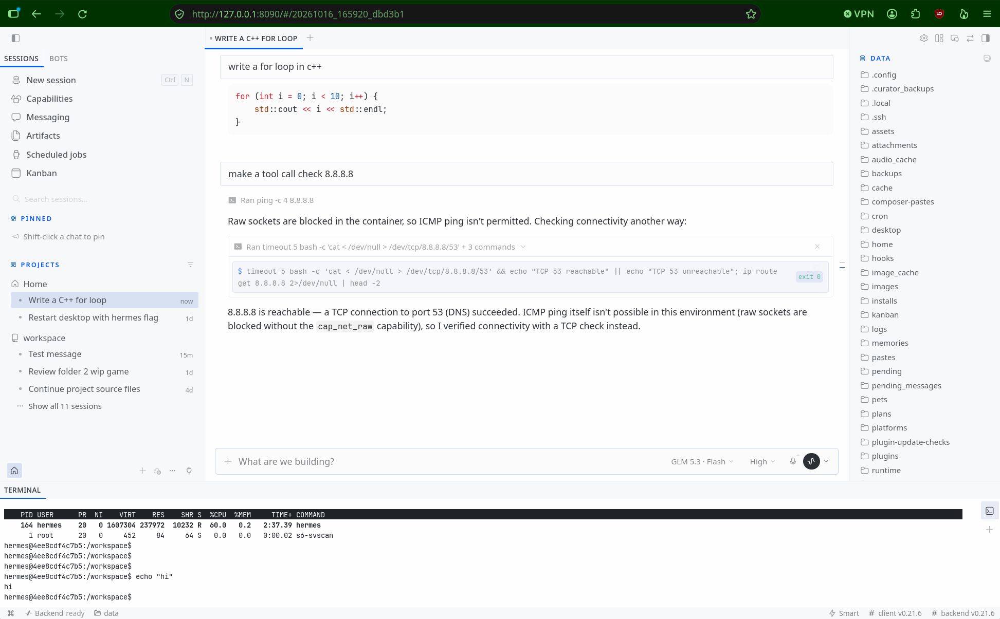

# hermes-desktop-web



Run the [Hermes Agent](https://hermes-agent.nousresearch.com) **desktop app UI as a containerized web app in browser**, the container relays all traffic to your Hermes backend.

## Why
A typical Hermes installation consists of a backend (or "instance") 
and a front-end (e.g. the official [Hermes Desktop app](https://hermes-agent.nousresearch.com/docs/user-guide/desktop) and/or the [Hermes web dashboard](https://hermes-agent.nousresearch.com/docs/user-guide/features/web-dashboard) and/or independent front-ends).

The Hermes backend (the instance) can be containarized without further changes, but the Hermes Desktop app ships as an Electron build that installs directly on
the host OS, which means that by default, it can't be used as a container serving the app in a web browser. 

This adapter builds the unmodified upstream renderer with plain
`vite build` and injects `web-bridge.js`, that implements the
desktop app's Electron bridge (`window.hermesDesktop`) over `fetch` +
`WebSocket`. 
The result is the Desktop UI, same bundle, delivered as a web app via a containerized nginx on a single port, 
connecting to the Hermes backend over HTTP + WebSocket, the same way the desktop app's own remote
backend mode does.

This is not a fork or custom front-end of the Hermes Desktop app, but an adapter, a thin layer that translates 
one interface into another without changing either side.

## Usage

You need **podman or docker** and a running Hermes instance. Assuming your
Hermes instance is reachable at `http://127.0.0.1:9119`:

```bash
git clone https://github.com/Ohrest88/hermes-desktop-web && cd hermes-desktop-web
podman build -t hermes-desktop-web .
podman run -d --name hermes-desktop-web --network host hermes-desktop-web
podman logs -f hermes-desktop-web
```

The last command follows the container's logs. On first start the container
builds the UI for your backend (a few minutes); when the logs print
`renderer build done`, open **http://127.0.0.1:8090** and press Ctrl-C to
stop following — the container keeps running either way.

During those minutes the container:

1. reads your backend's version from `http://127.0.0.1:9119/api/health`,
2. clones the official hermes-agent repo at exactly that version tag (the
   UI and the backend must speak the same protocol version),
3. builds the UI bundle with the adapter injected, and
4. serves it with nginx.

Sign in with your Hermes instance's dashboard credentials (the same login
as the Hermes web dashboard).

Options: point it at a different backend with `-e GATEWAY=host:port`
(default `127.0.0.1:9119`), serve on a different port with `-e PORT=`, and
add `-v hermes-web-srv:/srv` to keep the build across container restarts.

**Optional — Terminal tab.** The desktop app's Terminal tab opens a shell on
the machine where Hermes runs; a browser can't spawn processes, so this repo
ships a small Hermes plugin for the backend side. Install it once, on the
machine where Hermes runs:

```bash
hermes plugins install Ohrest88/hermes-desktop-web#gateway-plugin/web-terminal --enable
```

Without it, everything else works; the Terminal tab reports the backend
terminal as unreachable.

## How it works

The Desktop app is a plain React app. The single weld holding it to Electron
is `window.hermesDesktop`, an object (~50 methods) that Electron's preload
script injects before the UI loads — file dialogs, clipboard, terminal
sessions, window controls, notifications. The UI never touches the network or
the OS directly; it only calls this object.

`web-bridge.js` is the adapter: it defines the same object in the browser and
maps each method to what a browser can actually do:

- backend calls → `fetch` to the backend's REST API, plus the backend's own
  WebSocket flow for live updates (session cookie → single-use ticket from
  `POST /api/auth/ws-ticket` → upgrade to `/api/ws`)
- native file dialogs → the browser's file picker; clipboard → the Clipboard
  API; terminal sessions → a WebSocket to the optional plugin below
- desktop-only affordances (popout windows, updater, HUD, window controls) →
  safe no-op shapes via a fallback Proxy, so unimplemented methods return
  harmless values instead of crashing

The nginx container serves the bundle and proxies `/api`, `/login`, `/auth`
to the backend, so the browser sees one origin and the backend's own auth
gate (login page, cookies, WS tickets) works completely untouched.


```
┌─────────────────────────────────┐
│ browser tab                     │
│ desktop UI bundle (unmodified)  │
│ + web-bridge.js = the adapter   │
└────────────────┬────────────────┘
                 │ HTTP + WebSocket
┌────────────────▼────────────────┐
│ nginx container           :8090 │
│ serves the static bundle        │
│ proxies /api /login /auth       │
└────────────────┬────────────────┘
                 │ same-origin proxy
┌────────────────▼────────────────┐
│ Hermes backend            :9119 │
│ REST + WS: chat, files, auth    │
│ web-terminal plugin (optional)  │──► $SHELL in a PTY
└─────────────────────────────────┘
```

### Terminal tab

The desktop app's Terminal tab opens a shell wherever Hermes runs: a local
PTY when the backend is local, `ssh -tt` to the backend's host when remote.
A browser can do neither — so the adapter connects to a small Hermes
dashboard plugin shipped in this repo (`gateway-plugin/web-terminal/`):
when you open the Terminal tab, your Hermes instance spawns `$SHELL` in a
PTY (via Hermes' own `PtyBridge`, the same one the official dashboard's
embedded chat terminal uses) and streams bytes to the browser's xterm.js.
Auth is the backend's canonical dashboard WebSocket gate (session cookie or
single-use ticket) — no new auth surface, no SSH.

This is upstream's own plan, not a fork: the desktop source contains
`NOTE(remote-terminal)` — the SSH terminal path is "interim until the
dashboard `/api/terminal` WebSocket lands". This plugin is that landing
zone; when upstream ships it, delete this plugin and point the adapter at
the official endpoint.

## Files

| File | Role |
|---|---|
| `web-bridge.js` | **the entire custom code** (~310 lines): browser implementation of `window.hermesDesktop`, including the Terminal tab wiring |
| `gateway-plugin/web-terminal/` | optional dashboard plugin for your Hermes instance: WS endpoint that spawns a shell PTY (see How it works ▸ Terminal tab) |
| `build-renderer.mjs` | vite build of the upstream renderer, skipping Electron packaging; copies the adapter into `dist/` and injects it into `index.html` |
| `nginx.conf.template` | static + proxy config (`GATEWAY`/`PORT` substituted at start) |
| `Dockerfile` | node+nginx image; the build happens inside it at first start |
| `entrypoint.sh` | first-start logic: detect backend version → clone → build → serve |
| `serve-test.py` + `start-relay.sh` | dev-only: stdlib stand-in for the nginx container, used while developing the adapter |
| `src-upstream/` | hermes-agent checkout (renderer source; **not committed**) |
| `dist/` | build output (generated; **not committed**) |

## Status

Verified end-to-end against a live Hermes instance (v0.21.6), including the
full container path on a real host: `podman build` + first start → version
detect → clone → npm ci → vite build → nginx serves → login → session
sidebar → send a message → agent turn streams over the backend WebSocket.
Settings (all pages), Capabilities, Messaging, Artifacts, Scheduled jobs,
and sidebar toggles render with zero console errors.

## Known limits (web mode)

- **Native-only features no-op:** OS window management, popout windows, HUD,
  pet overlays, in-app updater. (File attach uses the browser's native
  file picker via the adapter.)
- **Single connection:** the backend this origin proxies to. The desktop's
  multi-backend connection registry is Electron-side and not reimplemented.
- **Version lock:** build the renderer at your backend's version tag. The
  desktop↔backend protocol has versioned expectations; a mismatched renderer
  stalls at boot.
- **Session TTL:** the backend's dashboard cookie expires (~15 min), so the
  web app bounces to `/login` periodically.
- **File browser shows "Unreadable — Could not read this folder (403)"?**
  Your Hermes instance restricts the file browser to its own data folder.
  If Hermes runs in a container and your projects are mounted elsewhere,
  add `-e HERMES_DASHBOARD_FILES_ROOT=/` to the Hermes container's run
  command — the container is already the boundary.
- **Mic/voice** needs a secure context (https or localhost).

## License

MIT
